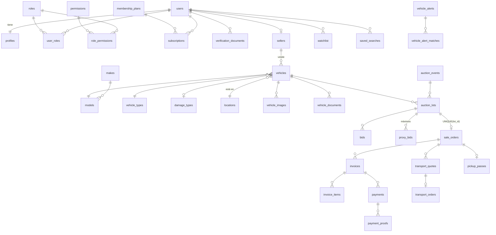

# Arquitectura — copart (réplica académica)

## 1. Visión general

```mermaid
flowchart LR
  B[Navegador<br>HTML/CSS + JS ligero] -- HTTP páginas EJS --> A[Express 5]
  B -- fetch JSON /api/v1 + CSRF --> A
  B <-- Socket.IO --> S[Realtime]
  A --> SV[Servicios de dominio<br>bidding · auctionEngine · orders · catalog · alerts · reports · pdf]
  S --> SV
  E[Reloj del servidor<br>tick 1 s] --> SV
  SV --> P[(PostgreSQL 17)]
  A --> F[storage/uploads (público)<br>storage/private (documentos)]
```

- **Monolito modular** en Node.js 24: un solo proceso sirve páginas, API REST v1, WebSocket y el reloj de subastas. Toda la lógica de negocio vive en `src/services/` y la usan por igual las páginas, la API y el WebSocket.
- **Páginas renderizadas en servidor (EJS)**: SEO, primera carga rápida y control total del CSS para reproducir las capturas. El JS del cliente (`public/js/app.js`) solo conecta formularios/botones a la API (`data-api`), muestra errores por campo y toasts.
- **PostgreSQL** es la única fuente de verdad, incluido el estado del reloj de cada lote (`ends_at`): si el servidor se reinicia, la subasta continúa donde estaba.

## 2. Por qué este stack (decisiones justificadas)

| Opción sugerida | Decisión | Motivo |
|---|---|---|
| Next.js + NestJS + Prisma | Express + EJS + SQL | El proyecto anterior era Node sin framework; mantener un stack coherente y sencillo de explicar. SQL explícito permite defender bloqueos y transacciones línea a línea. |
| Prisma | Migraciones SQL versionadas (`db/migrations`) | Control directo de índices parciales, `CHECK` de estados y triggers. |
| Redis | No | Un solo proceso: el bloqueo de fila en PostgreSQL basta. Para escalar a varios nodos: Redis pub/sub como adaptador de Socket.IO y un único worker del reloj. |
| Socket.IO | Sí | Reconexión automática, salas, acks (confirmación de puja). |
| argon2 | `@node-rs/argon2` (Argon2id) | Binarios precompilados, sin compilar en Windows. |
| Zod | Sí | Validación de todas las entradas en servidor con mensajes por campo. |

## 3. Modelo de datos (resumen)

38 tablas (`001_init.sql` + `002_owner_member.sql`, que añade `lot_views` y columnas de suplantación, roles propios, Buy It Now y contraofertas). Importes en **céntimos (BIGINT)**. Estados como `TEXT` + `CHECK`. Todas con `created_at`/`updated_at` (trigger).



Auxiliares: `sessions`, `password_resets`, `order_status_history`, `transport_events`, `notifications`, `email_outbox`, `support_tickets`, `audit_logs`, `system_settings`, `content_pages`, `banners`.

**Integridad garantizada por la base de datos**
- `sale_orders.lot_id UNIQUE` → imposible adjudicar un lote dos veces.
- `auction_lots_vehicle_open_uq` (índice parcial) → un vehículo no puede estar en dos lotes abiertos.
- `subscriptions_one_active_uq` → una sola membresía activa por usuario.
- `bids_idempotency_uq (user_id, idempotency_key)` → un reintento no duplica la puja.
- `users_email_lower_uq` → email único sin distinguir mayúsculas.

## 4. Máquinas de estado

**Evento de subasta:** `scheduled → live → ended` (o `cancelled`).

**Lote:** `prebidding → live → awarded | pending_seller_approval | no_sale` · `pending_seller_approval → awarded | no_sale` · `prebidding → cancelled`.

**Vehículo:** `draft → pending_approval → approved | rejected` · `rejected → draft` · `approved → sold | withdrawn` · `no_sale → approved` (re-listable).

**Compra** (`ORDER_TRANSITIONS` en `services/orders.js`, validado en servidor + historial):
```
pending_payment → payment_review → paid → ready_for_pickup → completed
                ↘ cancelled          ↘ in_transport ───────↗
```

## 5. Motor de pujas (`services/bidding.js`)

1. Elegibilidad: rol comprador, plan con `can_bid`, documentos aprobados si el plan lo exige.
2. Se cargan los ajustes **antes** de la transacción (evita agotar el pool bajo carga — bug encontrado por la prueba de concurrencia).
3. `BEGIN; SELECT … FROM auction_lots WHERE id=$1 FOR UPDATE` → las pujas del mismo lote se serializan.
4. Validaciones: lote abierto (prepuja o en vivo y `ends_at > now()`), no es el vendedor, límites del plan (por vehículo, nº de lotes y total por subasta), puja ≥ mínima.
5. **Proxy**: se guarda el máximo privado. Precio = `min(máx1, máx2 + incremento)`, nunca por debajo de la salida. Empate → gana quien alcanzó ese máximo primero.
6. Anti-sniping: si quedan < `bid_extension_seconds`, el cierre se extiende.
7. Se registra la puja (y la contrapuja automática si la hay), se notifica al superado, se audita, `COMMIT`, y se difunde `lot:update` por WebSocket.

**Reloj (`services/auctionEngine.js`)**: cada segundo abre eventos cuya hora llegó, cierra lotes vencidos (`FOR UPDATE` + revalidación de `ends_at`), crea orden + factura en la **misma transacción** y abre el siguiente lote. El navegador nunca decide la hora ni el ganador.

**Buy It Now (`bidding.buyNow`)**: misma transacción con `FOR UPDATE` que las pujas; solo en prepuja y si las pujas no alcanzaron el precio fijo; crea orden + factura (`sold_via='buy_now'`) y avisa al resto de pujadores. Dos clics simultáneos → un único comprador (probado).

**Contraofertas (`auctionEngine.sellerCounter` / `counterResponse`)**: lote `pending_seller_approval` → el vendedor propone un precio entre la puja más alta y la reserva → el mejor postor acepta (se adjudica a ese precio, `sold_via='counter_offer'`) o rechaza (`no_sale`, el vehículo vuelve al inventario).

## 5.1 Control del propietario (`routes/api/owner.js`, migración 002)

- **Suplantación auditada**: `sessions.impersonator_id`. La sesión original del admin se guarda en la cookie HttpOnly `ap_imp`; la sesión suplantada caduca en 2 h. No se puede suplantar a otro administrador ni cambiar contraseñas durante la suplantación. `audit_logs`: `user.impersonate.start/stop`.
- **RBAC editable**: `roles` deja de estar limitado a 5 códigos (`is_system`, roles personalizados). Matriz rol × permiso en `/admin/roles`. El menú de `/admin` se filtra por permiso, así que un rol propio (p. ej. *Content editor*) ve solo sus pantallas. Anti-bloqueo: el rol `admin` conserva siempre `users.manage` y `roles.manage`. El seed solo asigna permisos por defecto a roles/permisos nuevos (no deshace cambios del propietario).
- Gestión completa de cuentas (perfil, email, contraseña, sesiones, mensajes, borrado solo sin historial), vehículos creados por el admin en nombre de un vendedor, CMS con páginas y banners `top`/`home`.

## 5.2 Idioma y región (`lib/i18n.js`, migración 003)

- **6 idiomas** (`es` por defecto, `en`, `fr`, `ar`, `ru`, `pl`) por cookie `ap_lang`/`?lang=`. `t(clave)` traduce claves de interfaz y también **frases en español** (`t('Mis ofertas')` → *My Bids* / *Mes offres* / *مزايداتي* / *Мои ставки* / *Moje oferty*). Así las plantillas siguen siendo legibles en español. `ht(es, en)` cubre textos de una sola página. El árabe usa `unicode-bidi: plaintext` por bloque: el texto va de derecha a izquierda sin romper la maqueta.
- **11 regiones** por cookie `ap_region`/`?region=`. `locations.country` (ISO-2) clasifica cada sede. `catalog.searchLots({country})` y `catalog.facets(country)` filtran el buscador, la portada, los contadores y las sedes. Un número de lote, una sede o una subasta concretos no se filtran, y `?country=all` muestra todo. La API pública solo filtra si se pasa `country`.
- Seed: 11 sedes ficticias fuera de España y la subasta *International Online Sale (demo)*, con la marca `intl_seeded_at` para que también se añada a una base ya sembrada.

## 5.3 Mi cuenta y pasarela de pagos (`routes/account.js`, `routes/api/account.js`, `services/payments.js`, migración 004)

- Pasarela **enchufable**: `PROVIDERS` con interfaz `tokenizeCard / charge / refund`. Solo `demo` está implementado: acepta exclusivamente tarjetas de prueba y simula cargos, rechazos y reembolsos. Stripe, Mercado Pago, Wompi y PayPal aparecen con sus variables de entorno y el estado "adaptador pendiente". `activeProviderCode()` vuelve a `demo` si el proveedor pedido no está implementado o le faltan claves.
- `payment_methods` guarda solo marca, últimos 4, caducidad y el token del proveedor (nunca PAN ni CVC). Hay una única tarjeta predeterminada (índice parcial). `deposits`: `held → refund_requested → refunded`; el reembolso lo aprueba Finanzas (`finance.review`).
- `title_addresses`: dirección por sedes (`location_codes`), solo dentro del país de la región del sitio. `profiles.preferences` (JSONB) guarda las preferencias validadas una a una (recogida, sedes favoritas, intereses, comunicaciones, envío automático).
- Cambiar el correo exige la contraseña. Ni eso ni añadir tarjetas o depósitos se permite durante una suplantación. "Cerrar las demás sesiones" conserva la sesión actual.

## 6. Seguridad

- Contraseñas **Argon2id**; sesiones con token aleatorio guardado como **hash SHA-256**; cookie `HttpOnly`, `SameSite=Lax`, `Secure` en producción.
- **CSRF** double-submit (cookie `ap_csrf` + cabecera `X-CSRF-Token`) en toda mutación.
- **RBAC por permisos** en cada endpoint (`requirePerm`), no solo ocultando botones. Roles → permisos en `role_permissions`.
- **Rate limiting**: login, registro, pujas, contacto, alertas.
- **Subidas**: tipo real por firma de bytes (no por MIME declarado), nombre aleatorio, tamaño máximo; documentos privados fuera de la carpeta pública y servidos solo al propietario o revisores.
- **PIN de retiro**: logística lo valida contra un hash; las vistas de personal nunca lo muestran; 5 intentos fallidos lo revocan.
- **Helmet + CSP** sin scripts inline; HTML de páginas CMS saneado; consultas siempre parametrizadas; errores 500 sin detalles internos.
- **Auditoría** (`audit_logs`) de logins, pujas, aprobaciones, pagos, PIN, ajustes y exportaciones.

## 7. Escalado futuro (para la defensa)

Varios nodos: `@socket.io/redis-adapter` para difundir eventos entre instancias; un único proceso “reloj” (o `pg_advisory_lock`) para cerrar lotes; almacenamiento S3 tras la misma interfaz de `lib/uploads.js`; colas para correos reales.

## 8. Pruebas

| Tipo | Archivo | Cubre |
|---|---|---|
| Unitarias | `tests/unit.test.js` | Tabla de incrementos, formato de moneda, CSV |
| Integración API+BD | `tests/integration.test.js` | RBAC/CSRF, registro→membresía→documentos, vendedor→admin→buscador, **24 pujas concurrentes**, idempotencia, sala en vivo por WebSocket con 2 clientes, cierre por reloj sin duplicados, factura, pagos, Finanzas, PIN, transporte, decisión del vendedor, CSV, auditoría |
| Propietario + miembro | `tests/owner.test.js` | Alta con varios roles, suplantación y regreso (auditado), roles personalizados y anti-bloqueo, **Buy It Now concurrente**, contraofertas, vehículo creado por el admin, CMS, borrado seguro, 21 pantallas del área del miembro |
| E2E | `e2e/*.spec.js` | Visitante (desktop + móvil 390px), guest, premium, vendedor, paneles de staff, **2 navegadores en la sala en vivo**, propietario entra como comprador y vuelve |
| Idioma y región | `tests/i18n.test.js` | Los 6 idiomas en menú y tablero, cookie persistente, árabe, filtro por país en resultados/sedes, `?country=all`, API |
| Mi cuenta y pagos | `tests/account.test.js` | 13 páginas de cuenta, teléfono/direcciones/correo/contraseña, solo tarjetas de prueba (rechazo de tarjetas reales y Luhn), número nunca guardado, depósito, rechazo, reembolso por Finanzas, títulos por región, preferencias, cerrar otras sesiones, admin de pasarelas sin mostrar claves |
| Humo | `scripts/crawl.js` | 150 páginas con cada rol, idioma y región |
